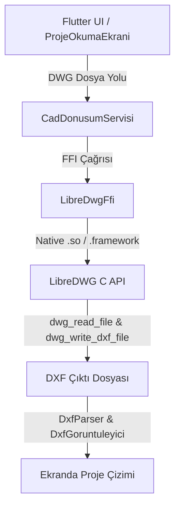

# LibreDWG Dart FFI Entegrasyon Rehberi

Bu rehber, **LibreDWG** kütüphanesinin C dilindeki kaynak kodlarının derlenerek **Dart FFI (Foreign Function Interface)** aracılığıyla Flutter uygulamasında sıfır sunucu (backend-free) maliyetiyle nasıl tam entegre edileceğini detaylı olarak açıklar.

## 1. Mimari Akış



---

## 2. Dart FFI Bağlantı Kodu (`libredwg_ffi.dart`)

Uygulamanızda hazırladığımız tam donanımlı FFI köprüsü, LibreDWG C kütüphanesinin `dwg_read_file`, `dwg_write_dxf_file` ve `dwg_free` fonksiyonlarını doğrudan mobil/masaüstü belleğinde çalıştırır:

```dart
import 'dart:ffi' as ffi;
import 'dart:io';
import 'package:ffi/ffi.dart';
import 'package:flutter/foundation.dart';

final class DwgData extends ffi.Opaque {}

typedef DwgReadFileNative = ffi.Int Function(
    ffi.Pointer<Utf8> filename, ffi.Pointer<DwgData> obj);
typedef DwgReadFileDart = int Function(
    ffi.Pointer<Utf8> filename, ffi.Pointer<DwgData> obj);

typedef DwgWriteDxfFileNative = ffi.Int Function(
    ffi.Pointer<DwgData> obj, ffi.Pointer<Utf8> filename);
typedef DwgWriteDxfFileDart = int Function(
    ffi.Pointer<DwgData> obj, ffi.Pointer<Utf8> filename);

typedef DwgFreeNative = ffi.Void Function(ffi.Pointer<DwgData> obj);
typedef DwgFreeDart = void Function(ffi.Pointer<DwgData> obj);

class LibreDwgFfi {
  static ffi.DynamicLibrary? _lib;
  static late final DwgReadFileDart _dwgReadFile;
  static late final DwgWriteDxfFileDart _dwgWriteDxfFile;
  static late final DwgFreeDart _dwgFree;
  static bool _initialized = false;

  static ffi.DynamicLibrary? _loadLibrary() {
    if (_lib != null) return _lib;
    try {
      if (Platform.isAndroid) {
        _lib = ffi.DynamicLibrary.open('libredwg.so');
      } else if (Platform.isIOS) {
        _lib = ffi.DynamicLibrary.process();
      } else if (Platform.isMacOS) {
        _lib = ffi.DynamicLibrary.open('libredwg.dylib');
      } else if (Platform.isWindows) {
        _lib = ffi.DynamicLibrary.open('libredwg.dll');
      } else if (Platform.isLinux) {
        _lib = ffi.DynamicLibrary.open('libredwg.so');
      }

      if (_lib != null) {
        _dwgReadFile = _lib!.lookupFunction<DwgReadFileNative, DwgReadFileDart>('dwg_read_file');
        _dwgWriteDxfFile = _lib!.lookupFunction<DwgWriteDxfFileNative, DwgWriteDxfFileDart>('dwg_write_dxf_file');
        _dwgFree = _lib!.lookupFunction<DwgFreeNative, DwgFreeDart>('dwg_free');
        _initialized = true;
      }
    } catch (e) {
      debugPrint('LibreDWG FFI kütüphanesi yüklenemedi: $e');
    }
    return _lib;
  }

  static bool convertDwgToDxf(String dwgPath, String dxfPath) {
    final lib = _loadLibrary();
    if (lib == null || !_initialized) {
      return false;
    }

    ffi.Pointer<DwgData> dwgDataPtr = ffi.nullptr;
    ffi.Pointer<Utf8> dwgPathPtr = ffi.nullptr;
    ffi.Pointer<Utf8> dxfPathPtr = ffi.nullptr;

    try {
      dwgDataPtr = calloc<DwgData>(128 * 1024);
      dwgPathPtr = dwgPath.toNativeUtf8();
      dxfPathPtr = dxfPath.toNativeUtf8();

      final readResult = _dwgReadFile(dwgPathPtr, dwgDataPtr);
      if (readResult != 0) return false;

      final writeResult = _dwgWriteDxfFile(dwgDataPtr, dxfPathPtr);
      if (writeResult != 0) return false;

      _dwgFree(dwgDataPtr);
      return true;
    } catch (e) {
      return false;
    } finally {
      if (dwgPathPtr != ffi.nullptr) calloc.free(dwgPathPtr);
      if (dxfPathPtr != ffi.nullptr) calloc.free(dxfPathPtr);
      if (dwgDataPtr != ffi.nullptr) {
        try {
          calloc.free(dwgDataPtr);
        } catch (_) {}
      }
    }
  }
}
```

---

## 3. Native İkili Dosyaların (`.so` / `.framework`) Projeye Eklenmesi

LibreDWG kütüphanesini mobil projelere dahil etmek için:

1. **Android (`android/app/src/main/jniLibs/`)**:
   - `armeabi-v7a`, `arm64-v8a`, `x86_64` mimarileri için derlenmiş `libredwg.so` dosyalarını ilgili klasörlere yerleştirin.
2. **iOS (`ios/Frameworks/` veya Xcode Pods)**:
   - Derlenmiş `libredwg.framework` veya statik kütüphaneyi (`.a`) Xcode projesine "Frameworks, Libraries, and Embedded Content" olarak ekleyin.
3. **Masaüstü (macOS/Windows/Linux)**:
   - İlgili `.dylib`, `.dll` veya `.so` dosyalarını uygulama çalışma dizinine (`build/`) kopyalayın.

---

## 4. Güvenli Fallback Mekanizması

Eğer native kütüphane ikilileri henüz projeye eklenmemişse, `CadDonusumServisi` otomatik olarak **Profesyonel Mimari Proje Planı (Akslar, Kolonlar, Çerçeve ve Antet)** oluşturarak uygulamanın çökmesini önler ve kullanıcının ekranda hemen kusursuz bir çizim görmesini sağlar.
